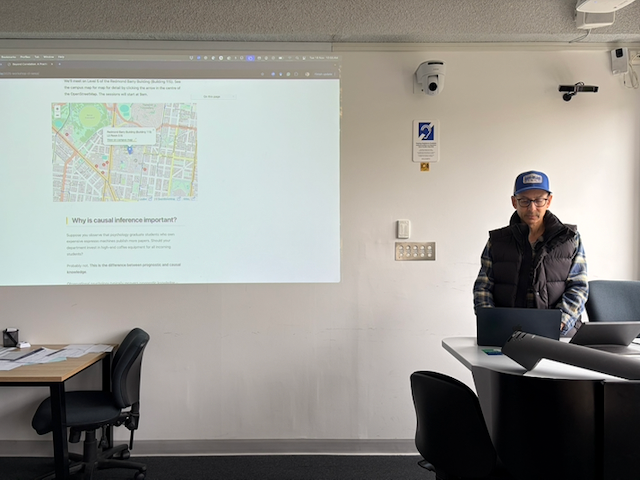
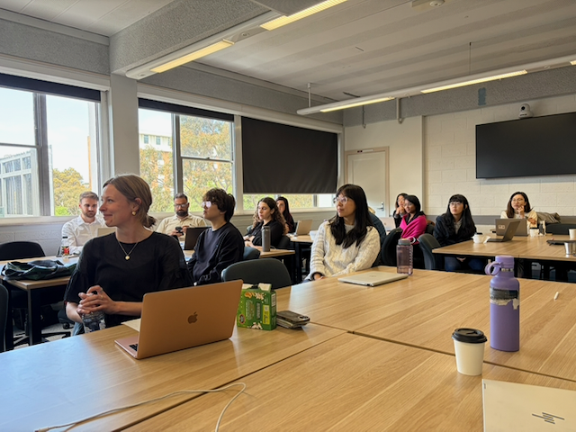
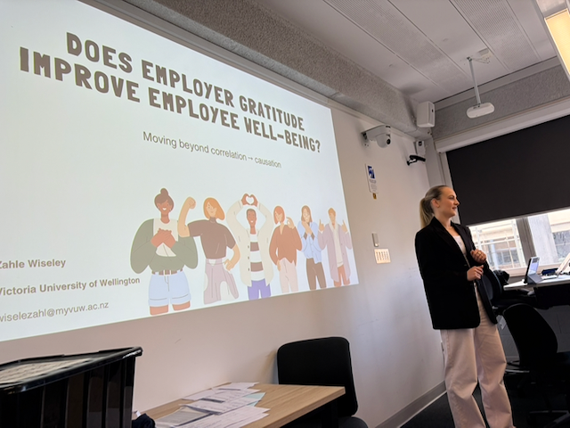
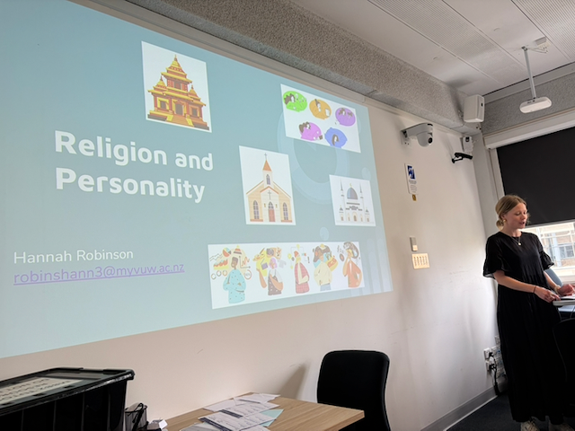
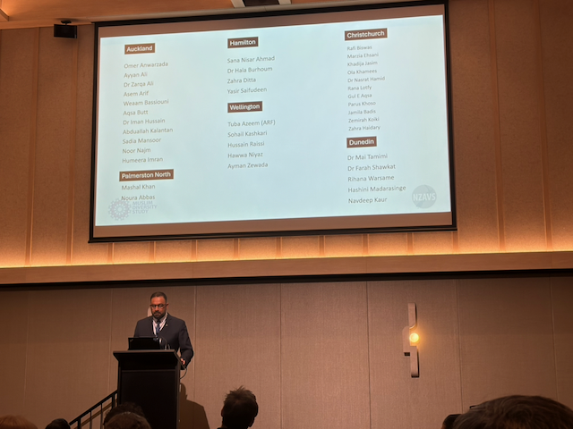
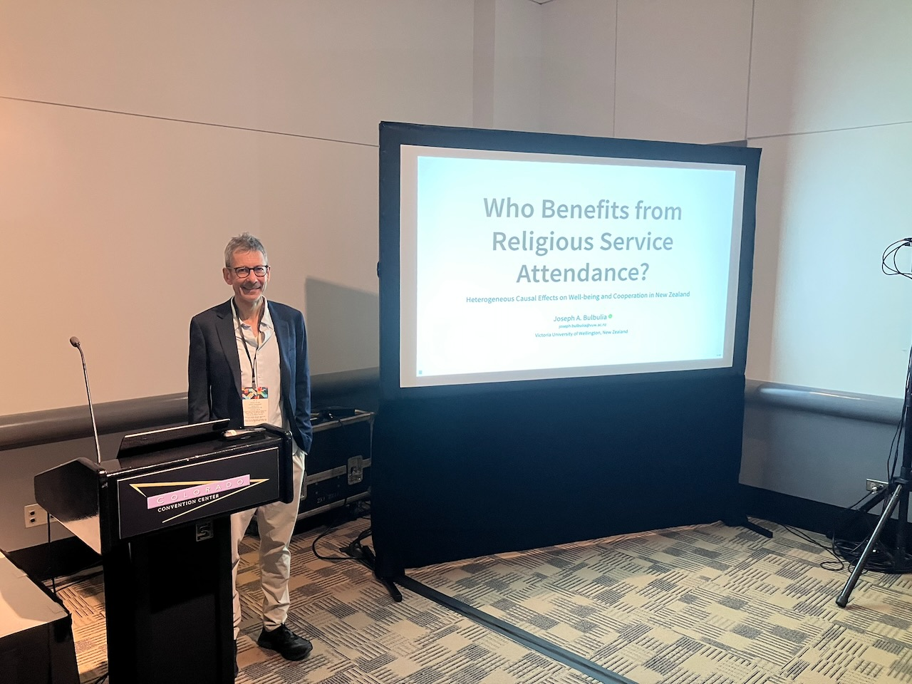

## 2026

### NZAVS-LMTP Workflow, Version 1, Published on Zenodo

**17 August 2026 | Zenodo**

Version 1 of our longitudinal causal workflow for the New Zealand Attitudes and Values Study is now on Zenodo. Studies following the workflow register their target trial, acceptable fallback questions, identification assumptions, and analysis code before outcomes enter estimation. [DOI](https://doi.org/10.5281/zenodo.21932992) · [Lab Report](reports/nzavs-lmtp-workflow.qmd)

Estimation uses the sequentially doubly robust estimator in `lmtp`, called through [`margot`](https://go-bayes.github.io/margot/). Supported by Templeton Religion Trust award 2021-0418.

---

### `boilerplate` 1.4.0 Published on CRAN

**12 July 2026 | Comprehensive R Archive Network**

Version 1.4.0 of [`boilerplate`](https://cran.r-project.org/package=boilerplate) is on CRAN. JSON is now the default database format and RDS writing has been removed from package APIs. Existing trusted RDS databases remain readable and can be converted with `boilerplate_migrate_to_json()`.

---

### New Master's and Honours Students

**July 2026 | Victoria University of Wellington**

Putri Pristine (Master's) and Christina Cartwright (Honours) have joined the lab.

Putri is from Indonesia and is estimating the long-term causal effects of belief in God and belief in a spirit or life force on multidimensional well-being, asking whether holding both yields anything extra.

Christina is from Austria and previously worked in government. She is using causal forests and policy trees to estimate how the effects of volunteering on well-being vary across groups.

---

### New Cambridge Handbook Chapter Published

**June 2026 | Cambridge University Press**

Victor Counted, Maureen Miner, and Joseph Bulbulia published *Australia and New Zealand: The psychology of religion up to 2020* in *The Cambridge Handbook of the International Psychology of Religion*. [DOI](https://doi.org/10.1017/9781108771122.003)

---

### Two Articles at *Religion, Brain & Behavior*

**June 2026 | Religion, Brain & Behavior**

Two lab articles entered production at *Religion, Brain & Behavior*:

- *Beyond deficit narratives: Religious practice, meaning, and resilience in a national sample of New Zealand Muslims*, by M. Usman Afzali, Aarif A. Rasheed, Geoffrey Troughton, Kumar Yogeeswaran, Chris G. Sibley, and Joseph A. Bulbulia (published online 18 November 2026). [DOI](https://doi.org/10.1080/2153599X.2026.2645568)
- *Religion, cooperation, and prosocial behavior: Methods and evidence for causality*, by Michael McCullough, Don Davis, and Joseph Bulbulia. [DOI](https://doi.org/10.1080/2153599X.2026.2695639)

---

### Dr Inkuk Kim Moves to Georgia State University

**March 2026 | Georgia State University**

Dr Inkuk Kim has taken up a postdoctoral fellowship with [Don E. Davis](https://news.gsu.edu/coronavirus-expert/don-davis-jr/) at the HAPPI Lab at Georgia State University. He remains a Fellow of OTTO Lab, continuing work on environmental psychology, trust in science, and character formation across adulthood. We have not yet tested whether moving to Atlanta causes higher well-being.

---

### `religionmap.org` Is Live

**20 February 2026 | Victoria University of Wellington**

[`religionmap.org`](https://religionmap.org/) is live: open research infrastructure for mapping places of worship and supporting cross-cultural policy research. Code and workflows are at [github.com/go-bayes/places-of-worship](https://github.com/go-bayes/places-of-worship).

---

### Two New PhD Students

**January 2026 | Victoria University of Wellington**

Mekonnen Tsehay and Mohammad Islam have started their PhDs in the lab.

Mekonnen is from Ethiopia and is estimating the causal effects of religious ritual behaviours on health and well-being among religiously identified New Zealanders.

Mohammad is from Bangladesh and is estimating the causal effects of Right-Wing Authoritarianism and Social Dominance Orientation on prejudice.

---

## 2025

### SASP 2025 Pre-Conference Workshop in Melbourne

**19 November 2025 | University of Melbourne | 23 participants**

The lab travelled to Melbourne for SASP 2025, where Joseph Bulbulia ran a full-day pre-conference workshop (*Beyond Correlation: A Practical Introduction to Causal Inference in Observational Social Psychology*) on why cross-sectional regressions rarely answer the questions psychologists actually want to ask.

Two lab students presented their causal analyses:

- **Zahle Stewart**: *Does Employer Gratitude Improve Employee Well-being?* (NZAVS). [Slides (PDF)](https://www.dropbox.com/scl/fi/humnzsgo5blg7rrtvz3dt/Employer-Gratitude-and-Employee-Well-being.pdf?rlkey=oc4esqaip1loeaf7zt6eodx7n&dl=0)

- **Hannah Robinson**: *Religion and Personality* (NZAVS). [Slides (PDF)](https://www.dropbox.com/scl/fi/awse06fy0gh3vw208qo2b/Melbourne-Presentation-Religion-and-Personality-Hannah-Robinson.pdf?rlkey=no9p11rxzr79f049zeqwo8p1l&dl=0)

Collaborator **Dr Usman Afzali** (University of Otago, Muslim Flourishing Study) also presented on Muslim community-making and resilience in New Zealand.

::: {layout-ncol=2}
{group="sasp2025"}

{group="sasp2025"}

{group="sasp2025"}

{group="sasp2025"}
:::

{width=60% fig-align="center"}

**Resources:**

- Workshop website: [go-bayes.github.io/2025-workshop-ci-sasp](https://go-bayes.github.io/2025-workshop-ci-sasp/)
- Workshop materials: [github.com/go-bayes/2025-workshop-ci-sasp](https://github.com/go-bayes/2025-workshop-ci-sasp)
- Teaching software: [causalworkshop package](https://github.com/go-bayes/causalworkshop)

---

### SPARCC Causal Inference Workshop at UC San Diego

**10–13 August 2025 | University of California, San Diego**

Joseph Bulbulia taught a workshop on average and heterogeneous causal effects in observational panel data at UC San Diego. [Workshop materials](https://go-bayes.github.io/sparcc-day-2/)

---

### William Bier Interdisciplinary Award Lecture

**8 August 2025 | Denver, Colorado**

Joseph Bulbulia delivered the William Bier Interdisciplinary Award lecture (APA Division 36): *Who Benefits from Religious Attendance? Heterogeneous Causal Effects on Well-being and Cooperation in New Zealand* -- asking what holds up once we stop mistaking cross-sectional associations for causal effects.

{width=60% fig-align="center"}

[View presentation slides](presentations.qmd#apa-bier-2025)

---
