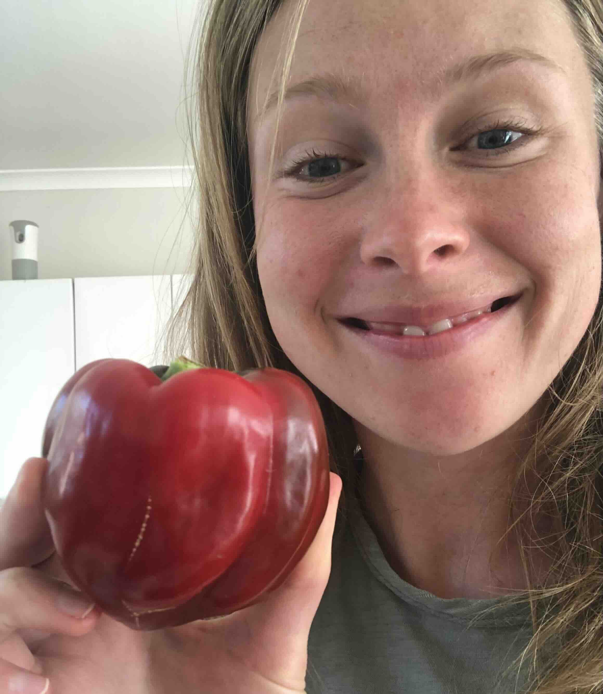
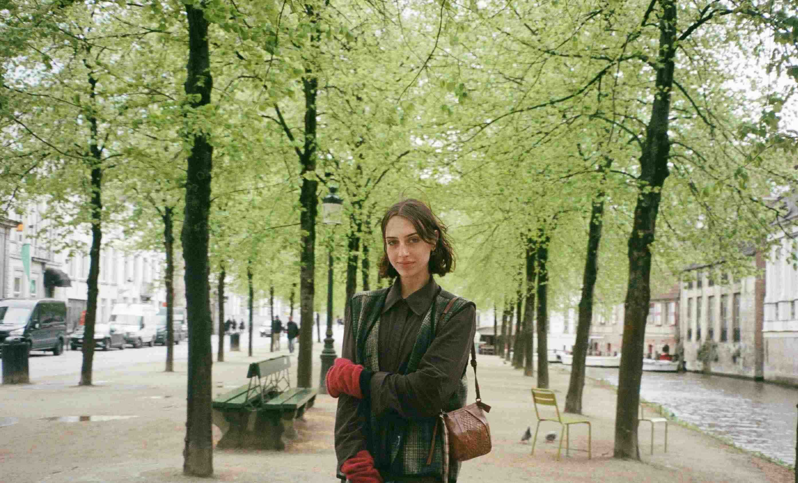
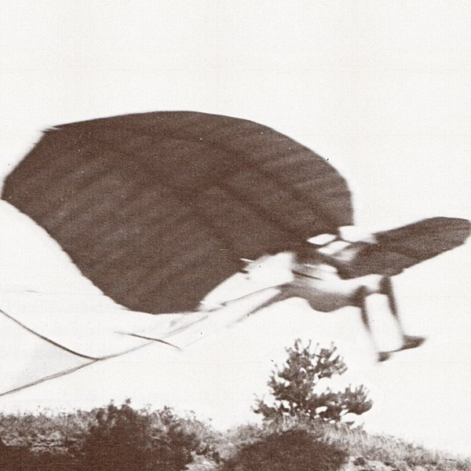
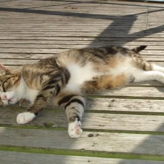

## Director

### Joseph Bulbulia

:::: {.columns}

::: {.column width="25%"}
{.team-photo}
:::

::: {.column width="75%"}
**Director, OTTO Lab**  
[joseph.bulbulia@vuw.ac.nz](mailto:joseph.bulbulia@vuw.ac.nz) · [University Profile](https://people.wgtn.ac.nz/joseph.bulbulia) · [Full CV](https://www.dropbox.com/scl/fi/jtlekxwxf05rfu1dw5hw9/bulbulia-j-a-cv.pdf?rlkey=4mink1sq6hftvje39t4y53s46&dl=0)

**About**

OTTO Lab is based in the [School of Psychological Sciences](https://www.wgtn.ac.nz/psyc) at Te Herenga Waka — Victoria University of Wellington.

Joseph Bulbulia teaches and researches in the [School of Psychological Sciences](https://www.wgtn.ac.nz/psyc) at Victoria University of Wellington. His research investigates the causes of human cooperation, conflict, and well-being, with a focus on the role of religion and values. Joseph specialises in methods for causal inference from observational data. He also directs the [Centre for Applied Cross-Cultural Research (CACR)](https://www.wgtn.ac.nz/cacr).

**Research Projects**
Joseph contributes to two major research projects:

1. **New Zealand Attitudes and Values Study (NZAVS)**: Joseph serves as a principal investigator on major NZAVS projects. He uses 15 years of repeated-measures longitudinal data from more than 76,000 New Zealanders to investigate religion, social cohesion, and trust.

2. **Pulotu Database of Pacific Religions**: As a founding co-investigator, Joseph uses this database of 116 Austronesian cultures to evaluate theories about the evolution of religious beliefs and their effects on social behaviour.

#### Supervision

Joseph supervises students in a broad range of areas, including:

- Personality and individual differences
- Political psychology
- Well-being and flourishing
- Religion (his primary interest)
:::

::::

---

## PhD Students

### Jessie Auckram

:::: {.columns}

::: {.column width="25%"}
{.team-photo}
:::

::: {.column width="75%"}
Jessie is investigating individual differences in personal resilience related to deprivation.

- **Project:** New Zealand Attitudes and Values Study (NZAVS)
:::

::::

### Jake Ireland

:::: {.columns}

::: {.column width="25%"}
{.team-photo}
:::

::: {.column width="75%"}
Jake graduated with a BSc in Psychology and Mathematics from Victoria University of Wellington in 2020, worked in cybersecurity, completed his Honours in 2024, and began his PhD in 2025. He is investigating the co-evolution of religious and political culture in the Pacific.

- **Project:** Pulotu
- **Methods:** Causal Machine Learning
- [ORCID Profile](https://orcid.org/0000-0003-3030-1341)
:::

::::

### Mohammad Islam

:::: {.columns}

::: {.column width="25%"}
{.team-photo}
:::

::: {.column width="75%"}
Mohammad is estimating the causal effects of Right-Wing Authoritarianism and Social Dominance Orientation on prejudice. He is from Bangladesh.

- **Project:** New Zealand Attitudes and Values Study (NZAVS)
:::

::::

### Mekonnen Tsehay

:::: {.columns}

::: {.column width="25%"}
{.team-photo}
:::

::: {.column width="75%"}
Mekonnen is estimating the causal effects of religious ritual behaviours on health and well-being among religiously identified people in New Zealand. He is from Ethiopia.

- **Project:** New Zealand Attitudes and Values Study (NZAVS)
:::

::::

---

## Master's Students

### Hannah Robinson

:::: {.columns}

::: {.column width="25%"}
{.team-photo}
:::

::: {.column width="75%"}
Hannah is researching the causal effects of religious service attendance on personality.

- **Project:** New Zealand Attitudes and Values Study (NZAVS)
:::

::::

### Putri Pristine

:::: {.columns}

::: {.column width="25%"}
<!-- TODO: add photo, then uncomment -->
<!-- {.team-photo} -->
:::

::: {.column width="75%"}
Putri is estimating the long-term causal effects of belief in God and belief in a spirit or life force on multidimensional well-being, asking whether joint belief yields synergistic benefits. She is from Indonesia.

- **Project:** New Zealand Attitudes and Values Study (NZAVS)
:::

::::

---

## Honours Students

### Christina Cartwright

:::: {.columns}

::: {.column width="25%"}
<!-- TODO: add photo, then uncomment -->
<!-- {.team-photo} -->
:::

::: {.column width="75%"}
Christina is using causal forests and policy trees to estimate how the effects of volunteering on well-being vary across groups. She is from Austria and previously worked in government.

- **Project:** New Zealand Attitudes and Values Study (NZAVS)
- **Methods:** Causal forests and policy trees
:::

::::

---

## Alumni

### Millie Rea

:::: {.columns}

::: {.column width="25%"}
{.team-photo}
:::

::: {.column width="75%"}
Millie worked with OTTO Lab as a research assistant, investigating extensions of lab workflows to policy settings with data from the Integrated Data Infrastructure (IDI).
:::
::::

### Boyang Cao

:::: {.columns}

::: {.column width="25%"}
{.team-photo}
:::

::: {.column width="75%"}
Boyang completed his Honours research with the lab, investigating the causal effects of prejudice on personality.

- **Project:** New Zealand Attitudes and Values Study (NZAVS)
:::
::::

### Zahle Stewart

:::: {.columns}

::: {.column width="25%"}
{.team-photo}
:::

::: {.column width="75%"}
Zahle received her Master of Science from Victoria University of Wellington in June 2026. Her thesis estimated the causal effects of perceived employer gratitude on multidimensional well-being, and she presented her findings at the 2025 SASP conference in Melbourne. Congratulations, Zahle!

- **Project:** New Zealand Attitudes and Values Study (NZAVS)
:::

::::

### Dr. Inkuk Kim

:::: {.columns}

::: {.column width="25%"}
{.team-photo}
:::

::: {.column width="75%"}
Dr. Inkuk Kim worked with OTTO Lab as a Research Fellow at the Centre for Applied Cross-Cultural Research and the School of Psychological Sciences at Victoria University of Wellington. He has since moved to a postdoctoral fellowship at the HAPPI Lab at Georgia State University (GSU), working with [Don E. Davis](https://news.gsu.edu/coronavirus-expert/don-davis-jr/). Inkuk remains a Fellow of OTTO Lab, working on environmental psychology, trust in science, and character formation across adulthood.

- [ORCID Profile](https://orcid.org/0000-0002-7694-6295) · [University Profile](https://people.wgtn.ac.nz/inkuk.kim) · [GitHub](https://github.com/Inkuk-Kim)
:::

::::

### Dr. John Mark Kempthorne

:::: {.columns}

::: {.column width="25%"}
{.team-photo}
:::

::: {.column width="75%"}
John Mark received his PhD from the School of Psychological Sciences at Victoria University of Wellington in 2025. His dissertation applied causal methods to time-series data from the New Zealand Attitudes and Values Study. He is now a postdoctoral fellow at the [Shaver Lab](https://anthropology.artsandsciences.baylor.edu/person/john-h-shaver).

- [ORCID Profile](https://orcid.org/0000-0001-6398-7509)
:::
::::

### Bella Chong

:::: {.columns}

::: {.column width="25%"}
{.team-photo}
:::

::: {.column width="75%"}
Bella received her Master's degree from Victoria University of Wellington in 2023. Her research investigated the causal effects of work hours on multidimensional well-being (published in *PLOS One*, 2026).

- [ORCID Profile](https://orcid.org/0000-0002-0206-0782)
:::
::::

---

## The Ottos

### Otto Lilienthal

:::: {.columns}

::: {.column width="25%"}
{.team-photo fig-alt="Otto Lilienthal in flight beneath a glider, above a sandy hillside, in 1891."}
:::

::: {.column width="75%"}
**Honorary Fellow, Direct Experimentation**

Otto (1848–1896) measured the flight of storks before he left the ground, and published the measurements in 1889. He then made more than two thousand glider flights between 1891 and 1896. The lab follows the first half of his method. Otto is not currently accepting students.

- **Project:** *Der Vogelflug als Grundlage der Fliegekunst* (1889)
- **Methods:** Observation, followed by experiment
- **Photograph:** Carl Kassner, 1891 (public domain)
:::

::::

### Otto (dog)

:::: {.columns}

::: {.column width="25%"}
{.team-photo fig-alt="A golden-brown dog looks over the back seat of a car."}
:::

::: {.column width="75%"}
**Research Fellow, Outcome Ascertainment**

Otto investigates the effect of a thrown ball on altitude. He serves as the study's only participant, and his adherence to treatment is complete. He joins the lab from Britain.

- **Project:** The ball
- **Methods:** Repeated measures
:::

::::

### Otto (cat)

:::: {.columns}

::: {.column width="25%"}
{.team-photo fig-alt="A tabby and white cat lies stretched out asleep on a sunlit wooden deck."}
:::

::: {.column width="75%"}
**Senior Fellow Emeritus, Control Condition**

Otto (2000–2015) served in the control arm for fifteen years, in New Zealand. He received no treatment and reported no complaints. Otto declined co-authorship on every paper, in advance.

- **Project:** None
- **Methods:** Remained at baseline
:::

::::

[New members of the lab are not required to be called Otto, although it would avoid confusion.]{.otto-note}

---

## Join the lab

Interested in joining the lab? Email Joseph Bulbulia at [joseph.bulbulia@vuw.ac.nz](mailto:joseph.bulbulia@vuw.ac.nz).
